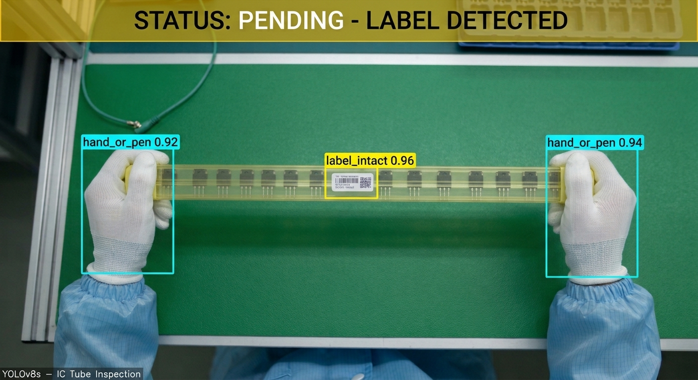
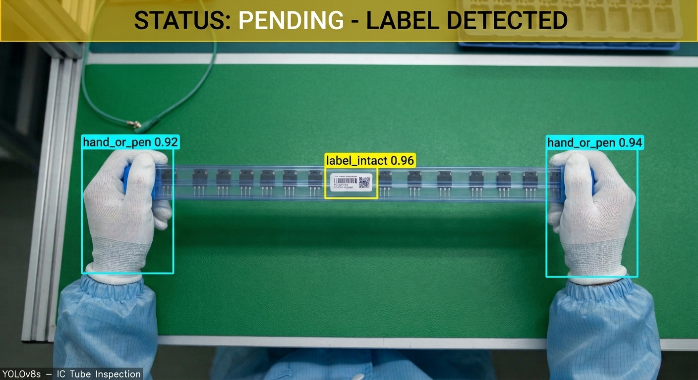
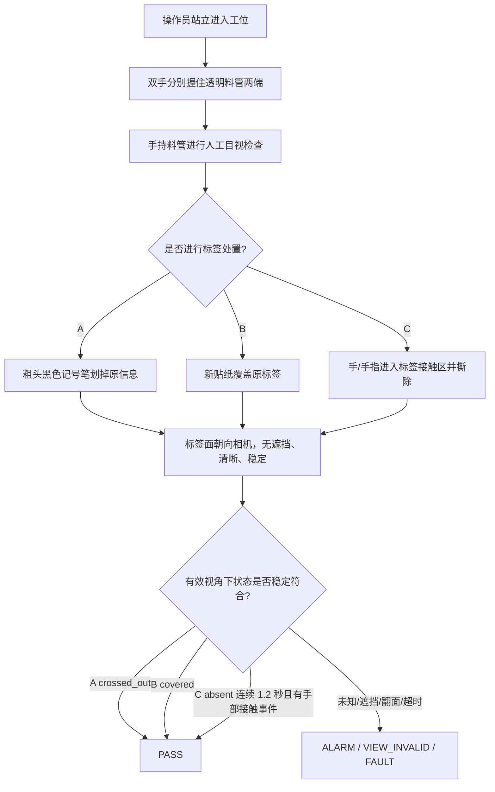
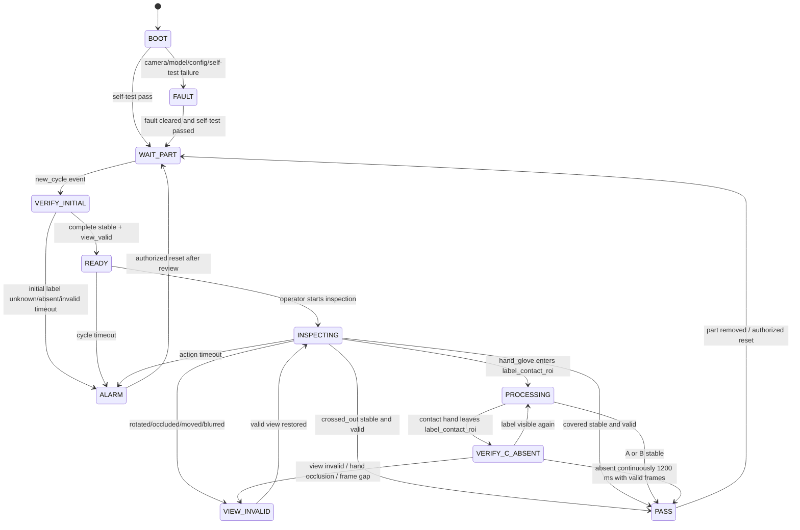

# IGBT 单管透明料管视觉防呆系统

## 从现场需求冻结、光学工位、数据标注、模型训练、FSM 开发到试产验收的工程总规范

| 文档属性 | 内容 |
|---|---|
| 文档版本 | **V2.0（基于两张现场参考图 + 深度研究复核）** |
| 修订日期 | 2026-11-20 |
| 项目对象 | IGBT 单管，TO-247-4，透明/有色防静电塑料料管，约 530 mm 长 |
| 人工作业方式 | **操作员站立，双手分别握持料管两端，手持料管进行目视人工检验** |
| 现有摄像头 | Logitech HD Pro Webcam C920 USB UVC |
| 目标系统 | Windows 11 x64 优先；旧 Windows 10 仅作为受控过渡环境 |
| 核心功能 | A 划掉 OR B 覆盖 OR C 手部接触后标签消失连续 1.2 秒，满足任一项放行 |
| 推荐语言 | Python 3.12（开发/训练/推理/FSM/API）；HTML/CSS/JavaScript（本地界面）；SQL（SQLite） |
| 推荐部署 | 工位 PC 本地运行，不依赖云端推理；训练和生产推理分离 |
| 文档用途 | 给项目负责人、现场工艺/设备人员、Codex 和软件开发人员的共同工程基准 |

> **重要安全声明**：本系统是工艺质量防错/防呆辅助系统，不是经认证的功能安全系统。普通 USB 摄像头、Windows PC、机器视觉模型和 Python 程序不能替代安全 PLC、安全继电器、光幕、急停或其他安全装置。第一版只给出 PASS/ALARM 提示和追溯记录。未经工艺、质量、电气、安全人员完成风险分析、验证和审批，不得将本系统作为危险机械的安全联锁。

> **资料使用原则**：两张现场参考图是本项目当前最有价值的视觉输入，但图中检测框、类别名称和置信度是截图中的示意叠加，不是经过独立测试的模型性能证明。本文把“图中直接可见事实”“工程推断”和“现场待测项”分开写，禁止将推断值当成已验收参数。

---

# 0. V2.0 修订摘要与最终技术决策

## 0.1 相比旧版 V1.1 的关键修订

| 项目 | 旧版容易产生的问题 | V2.0 修订决定 |
|---|---|---|
| 工位形态 | 容易被理解成料管放在固定 V 型治具上 | 明确是站立式人工目检，双手握料管两端；相机/灯具固定，工件由人手持 |
| 握持与接触 | 将“画面中出现手”作为 C 的候选条件 | 左右正常握持区与中央标签接触区分开；两端握持绝不触发 C |
| 类别设计 | `hand_or_pen` 将手和笔合成一类 | 重新拆成 `hand_glove` 与可选 `marker`；标签状态独立分类 |
| 缺失逻辑 | 全画面没有检测到标签就可能认为撕掉 | 必须经过工件定位/标签面有效性/无遮挡/清晰度检查；`absent` 仅在有效标签面 ROI 中成立 |
| 圆管翻转 | 标签转到背面可能被判成标签消失 | 新增 `view_valid` / `VIEW_INVALID`；无效视角不计时；要求标签面重新朝向相机，或升级多视角/方向确认 |
| C 动作计时 | 手遮挡期间也可能累计 1.2 秒 | 手离开标签接触区后，标签面重新呈现且图像有效，才开始 1.2 秒单调时钟计时 |
| C920 参数 | 把 OpenCV `set()` 当成锁定成功 | 必须检查设备能力范围、set/get 读回、画面稳定性；驱动不支持则阻止量产模式 |
| FOV 估算 | 没有把工作距离与标签像素数关联 | 按 C920 官方水平视角推导视场和 px/mm，所有数值仅用于布置初算，最终用尺和实拍校准 |
| `unknown` | 当作普通训练类别可能混入大量异质样本 | `UNKNOWN` 主要作为运行时拒识状态；模糊/遮挡样本保留在数据集中作拒识验证，不强制作为单一分类类别训练 |
| 商用许可 | 只看框架许可证 | 软件代码、预训练权重、模型文件、数据集、插件、字体、二进制依赖逐项登记 |
| 训练/测试 | 随机拆分同一视频帧容易数据泄漏 | 按物料批次、物理料管、拍摄日期、操作者/周期做分组隔离 |
| 指标 | 只看总体 Accuracy | 重点审计错误放行率 FAR，并设计独立挑战集和足够样本量 |

## 0.2 最终推荐技术路线

**推荐路线：独立开源标注工具 + 自有训练数据 + 许可证清晰的轻量分类模型 + 本地 ONNX 推理 + 自主 FSM。**

- 数据标注：X-AnyLabeling（独立运行，GPL-3.0，允许商业使用但需遵守 GPL 条款）；后期视频多人协作可用自托管 CVAT Community（MIT 核心许可，需额外审查打包依赖，例如 FFmpeg）。
- 训练：PyTorch + torchvision。模型结构代码许可较宽松；任何下载的预训练权重仍须单独核验其权重文件和来源数据许可。无法证明可商用时不引入该权重。
- 标签状态：固定标签区域优先做 ROI 分类；若标签在画面里移动明显，先定位管身/标签，再对规范化裁剪区分类。
- 手/手套：优先用现场实际手套数据训练 `hand_glove` 检测器或使用经验证的手部关键点方案。MediaPipe 可作为原型候选，但必须先验证白色针织手套适用性并核验具体模型资产许可，不能因 SDK 是 Apache-2.0 就推定模型文件也已核准。
- 推理：ONNX Runtime CPU 本地运行，后续按 PC 性能决定是否 GPU。
- 图像采集：OpenCV 采集适配器；相机参数控制独立封装。若需要严谨设置/读回，使用 Windows 原生 DirectShow 控制接口能力查询，不能只依赖 OpenCV 属性。
- 逻辑：Python FSM，不让神经网络直接决定 PASS。
- UI：FastAPI + HTML/JS 本地页面；SQLite 保存事件、模型版本、配置版本和证据图片。
- 工业联动：第一阶段仅本机提示；完成影子运行、工艺验收、电气评审后再考虑 PLC/IO。

**不推荐第一版直接从大型 GitHub 工业项目改代码；不推荐把 Roboflow 云端工作流作为量产运行依赖；不把 Ultralytics YOLO 作为默认闭源商业部署核心。** Ultralytics 官方说明其 AGPL-3.0/Enterprise 许可适用范围，私有商用部署前须取得明确法律/许可结论：https://www.ultralytics.com/license 。

## 0.3 三条不可妥协的工程原则

1. **无效画面不是缺失证据。** 遮挡、翻面、移出视野、失焦、过曝、强反光、掉帧均归为 `VIEW_INVALID` 或 `FAULT`，绝不等价于 `absent`。
2. **模型只输出视觉证据，FSM 决定业务结论。** PASS 必须由符合时序和质量门槛的稳定证据触发。
3. **系统不能确认就不放行。** 低置信度、类别冲突、图像质量差、设备故障、配置无效、周期状态不明都不得 PASS。

---

# 1. 真实工位参考图：事实提取与工程解释

## 1.1 黄管参考图（用户上传）



**图 1 说明**：图像分辨率为 1408×768（上传文件尺寸）。画面表现为绿色工作台/背景前，透明偏黄色长料管横向放置在视野中央；操作员戴白色手套，左、右手分别握持料管两端；信息标签位于料管中间附近。图上叠加了 `PENDING - LABEL DETECTED` 状态栏，中部标签框标为 `label_intact 0.96`，左右手框标为 `hand_or_pen 0.92` 与 `hand_or_pen 0.94`。

## 1.2 蓝管参考图（用户上传）



**图 2 说明**：视角、背景、人员手套位置和中部标签位置与黄管图基本一致，料管呈蓝色/蓝紫色外观。图上同样显示 `label_intact` 和两端 `hand_or_pen` 检测框。

## 1.3 图片直接支持的事实

| 直接可见事实 | 对工程设计的意义 |
|---|---|
| 人员双手分别握料管左右两端 | 正常握持是工艺常态，不能把“检测到手”视为标签操作 |
| 标签位于料管中央附近 | 第一版可优先把中部作为标签候选 ROI，但必须用真实样本核实标签偏差 |
| 料管在画面中横向延伸 | 相机/ROI 配置应考虑横向管轴方向和料管长度 |
| 工作台背景为绿色 | 训练与部署应尽量使用同类现场背景；背景更换会引起域偏移 |
| 存在黄色管和蓝色管两种外观 | 两种管色都必须进入训练、验证和测试；不能只验证单色 |
| 手部戴白色针织/防静电手套 | 手部检测必须用真实手套数据验证，不能只用裸手公开数据集假定适用 |
| 标签在整根料管画面中所占面积较小 | 全景图里标签像素可能不足；须核算视场和标签像素宽高 |
| `hand_or_pen` 是一个合并类别 | 不适合正式业务语义：人手和笔是不同目标，须拆分类别 |

## 1.4 图片不能证明的事项

以下项目不能从示意图的检测框或分数推出，必须现场验证：

- 图中 0.92、0.94、0.96 不是经过独立测试的精度，也不能当作真实模型指标。
- 不能证明 C920 在该位置能输出同样清晰度、分辨率或帧率。
- 不能证明 C920 曝光、对焦、白平衡可由目标 PC/驱动可靠锁定。
- 不能证明标签在所有料管上都位于正中或具有相同尺寸。
- 不能证明操作员只会平移料管，不会绕轴旋转、抬高、倾斜或把标签转到背面。
- 不能证明相机目前的安装高度、俯仰角、工作距离和光源位置。
- 不能证明手部框能判断真实“接触”；2D 框与 ROI 重叠仅表示视觉上的空间接近/遮挡代理证据。
- 不能证明 A 划线达标阈值、B 覆盖比例、C 撕除残留允许标准。

## 1.5 从图片得出的工程结论

1. 正常左右握持区应分别标定为 `left_grip_zone`、`right_grip_zone`；中间设置 `label_roi` 与 `label_contact_roi`。如手部活动进入中部，才有资格触发疑似标签接触事件。
2. `hand_or_pen` 应拆为 `hand_glove` 和 `marker`。`marker` 是可选增强项，A 动作最终状态通过标签分类判断即可，不必强制检测到笔。
3. 料管黄/蓝色至少作为采集维度和测试分层；初期建议训练一个统一模型，只有跨颜色测试性能差异明显且数据量足够时才考虑分模型。
4. 中央标签 ROI 不能固定写死在屏幕某几个像素，必须有工件位置/尺度有效性检查；若偏移超过标定范围则 `VIEW_INVALID`。
5. 绿色工作台是模型环境的一部分。若生产现场以后换成其他颜色、铺设新垫板或工作台有油污，应采集新数据并回归验证。

---

# 2. 业务流程、工艺定义与系统边界

## 2.1 现场实际流程



## 2.2 工艺负责人必须签字确认的定义

在开发前，工艺负责人必须书面回答：

| 业务定义 | 必须明确的问题 | 为什么重要 |
|---|---|---|
| A：划掉 | 划几道？黑笔覆盖哪些字段？笔迹覆盖多少才合格？是否允许仍能辨认字符？ | 模型必须有可标注的边界，不能由开发者猜“看上去划过” |
| B：覆盖 | 新贴纸尺寸、颜色、材质、透明度？至少覆盖原标签多少比例？是否允许露出边缘？ | 若覆盖贴纸与原标签视觉完全相同，视觉系统可能不可辨识 |
| C：撕掉 | 允许残胶、底纸、碎片、局部撕裂吗？必须完全去除还是只去掉主要信息？ | 决定 `absent`/残留类别的定义 |
| 初始状态 | 是否要求每根料管开始时必须有完整标签？ | 防止一开始无标签直接通过 |
| 标签位置 | 轴向位置和周向位置是否固定？公差是多少？ | 决定固定 ROI 是否可用、是否需要动态定位 |
| 料管颜色 | 黄、蓝是否仅有两种？是否有批次、透明度或壁厚变化？ | 防止模型只学到颜色而不是标签状态 |
| 呈现动作 | 操作完成后能否将标签正面朝向相机并保持约 1.5–2 秒？ | 单视角下 C 动作能否可靠判断的关键工艺条件 |
| 节拍 | 最长允许检测时间、报警后人工复核流程是什么？ | 决定超时与操作员交互 |

如果贴纸材料与原标签同色、同尺寸、同表面、完全重叠且边缘不可见，图像本身可能没有足够证据区分 B。此时不应继续堆模型，应改贴纸工艺（可识别的颜色/边缘/标识）或增加其他传感信息。

## 2.3 判定逻辑


定义：

\[
PASS = A \lor B \lor C
\]

- `A`：本周期初始 `complete` 已确认，随后有效视角下 `crossed_out` 稳定确认。
- `B`：本周期初始 `complete` 已确认，随后有效视角下 `covered` 稳定确认。
- `C`：本周期初始 `complete` 已确认，标签接触区发生手部进入/离开事件，手离开后标签面重新有效呈现，`absent` 连续有效 1200 ms。

**C 的 1200 ms 不是“摄像头没检测到标签的墙钟时间”，而是“标签面有效、ROI 清晰无遮挡、无运动失效、采集帧连续有效时的累计时间”。** `VIEW_INVALID`、帧间隔超限、标签返回可见、手再次遮挡均使该次连续计时作废。

## 2.4 关键物理可观测性限制

圆形透明料管可绕轴旋转。如果原标签随管子转到背面，单个正面摄像头看到的中央位置会变成“没有标签”，这与撕除后的图像可能完全相同。从单张 2D 图像无法凭空恢复背面是否仍有标签。这个问题是**观测不可辨识性**，不是换更大的模型就能解决。

第一版必须采用以下两种办法之一：

- **优先办法：工艺呈现姿态 + 可验证方向基准**。操作员处置后把标签所在表面朝向摄像头并停稳。关键在于：如果标签已被撕掉，原标签本身已经不能再作为朝向标志。因此必须有一个撕除后仍然可见、且与标签周向位置有固定几何关系的方向基准（例如工艺批准的管端定位特征/小型方向标记/非产品接触区识别特征），或通过经验证的工位动作约束保证料管不能绕轴滚转。只有操作员口头/界面确认“我已经正面朝向相机”，不能单独作为机器可验证的方向证据。
- **升级办法：增加观察角度/方向信息**。第二台斜视相机、两侧相机、管端方向标志或其他经工艺允许的非破坏性方向确认。注意：两台相机也不自动保证 360° 周向覆盖；必须根据允许旋转角度设计视角。

**当前两张参考图没有清晰显示撕除后仍存在的方向基准，也没有证明料管被防转约束。** 因此，“单台正面 C920 + 任意手持旋转 + 自动 C 撕除放行”目前仍是未关闭的可观测性风险。必须在 P0/P1 阶段由现场确认并关闭；否则 C 只能提示人工复核，不能作为自动 PASS。

不接受“反正连续 1.2 秒没看到标签就算撕掉”的设计。

---

# 3. 相机视场、安装位置与像素预算

## 3.1 C920 已知公开参数

Logitech 官方规格页：https://support.logi.com/hc/en-gb/articles/17368441997847-C920-Technical-Specifications

- USB 2.0；UVC 支持。
- 视频最高规格为 1080p@30fps（具体模式以设备/驱动读回为准）。
- 自动对焦（Auto Focus）镜头。
- 水平视场角约 70.42°，垂直视场角约 43.3°，对角约 78°。
- 焦距公开规格约 3.67 mm。

**官方规格说明了摄像头能力，不等于每项相机控制属性都能通过任意 Windows 后端设置。**

## 3.2 工作距离与水平视场初算

使用水平视场角估算：

\[
FOV_W = 2 \times D \times \tan(70.42^\circ/2)
\]

其中 `D` 为镜头前端到被摄平面的工作距离（米），`FOV_W` 为该平面的水平覆盖宽度（米）。

在 1920 像素宽、水平 FOV 70.42° 的理论情况下：

| 工作距离 D | 理论水平覆盖宽度 | 理论像素密度 | 50 mm 标签宽度约占像素 |
|---:|---:|---:|---:|
| 0.50 m | 0.706 m | 2.72 px/mm | 136 px |
| 0.60 m | 0.847 m | 2.27 px/mm | 114 px |
| 0.70 m | 0.988 m | 1.94 px/mm | 97 px |
| 0.80 m | 1.129 m | 1.70 px/mm | 85 px |
| 1.00 m | 1.412 m | 1.36 px/mm | 68 px |

以上是理想几何初算，不包括镜头畸变、自动数字裁剪、实际分辨率模式、标签倾斜和图像缩放。若标签实际宽度不是 50 mm，请使用实际尺寸重算。

**工程含义**：如果希望一台 C920 同时拍到整根 530 mm 料管、两只手和部分手臂，水平 FOV 可能需要约 0.85–1.0 m，工作距离初算约 0.60–0.71 m；但此时 50 mm 标签可能只有约 97–114 px 宽。若标签细字、细笔迹或贴纸边缘不足以辨认，就不能强行使用全景单摄，应考虑第二台近景相机或高分辨率工业相机。

## 3.3 必须测量的现场尺寸

拿钢尺和卷尺现场测量并写入 `docs/calibration_record.md`：

1. 摄像头镜头到料管标签面的工作距离。
2. 操作员正常双手握持时，从左手最外侧到右手最外侧的最大横向范围。
3. 料管中心相对地面/台面的高度范围。
4. 料管在人工目检过程中的左右平移、上下抬高、前后倾斜范围。
5. 操作员是否绕管轴旋转料管、最大旋转角度、是否会把标签翻到背面。
6. 标签实际宽、高、标签中心离料管两端的距离、标签贴在管周向哪一面。
7. 最细笔画、最窄贴纸边缘在原始 1920×1080 图中的像素宽度。

像素密度估算：

\[
px/mm = \frac{相机画面覆盖宽度方向的像素数}{实测画面覆盖宽度(mm)}
\]

标签像素宽度：

\[
LabelWidth_{px}=LabelWidth_{mm}\times px/mm
\]

不要只看总图是否“看起来清楚”。应放大检查黑笔最细有效笔迹、原标签打印细线、贴纸边缘以及残胶/撕裂边界。如果关键特征只有数个像素宽，分类结果会对运动模糊、压缩和反光非常敏感。

## 3.4 相机安装建议

- 优先采用固定刚性支架，避免操作台振动或手碰支架改变 ROI。
- 根据图 1/图 2 的俯视/斜俯视风格，先试相机位于工位正上方偏操作员前侧，光轴尽量接近标签展示面的法线；最终角度用反光试验决定。
- 相机必须避开两只手的常规运动路径，不应因为相机遮挡影响员工目视检查。
- 不强制要求全景摄像头一定要看清手腕和身体；第一视角优先保证标签 ROI 的像素质量。若要识别标签接触事件，必须能看见手进入中央标签接触区。
- 设置显示器对准提示框，指导操作员短暂把标签正面展示给相机；不能让操作员为触发按钮而松开料管。
- 如果操作员始终双手握住两端、无法腾出手按“开始周期”，可选择脚踏开关、工位传感器、由上一工序触发或独立大按钮（需评估是否影响安全与动作）。第一版也可由管理端测试按钮启动模拟周期。

---

# 4. 光学和机械工位设计

## 4.1 透明管与有色管的成像难点

透明/半透明圆管可能产生：
- 管壁镜面高亮条纹；
- 圆柱曲面折射造成背景扭曲；
- 黄管/蓝管对光线和背景颜色的不同调制；
- 管内 IGBT 引脚、黑色器件和文字标签互相叠加；
- 操作员白色手套与浅色标签在局部区域亮度接近；
- 标签表面覆膜/涂层反光导致笔迹或贴纸边缘消失。

不要只通过增加模型规模解决这些问题。优先调整灯、扩散片、相机角度、偏振、背景和曝光。

## 4.2 分阶段光学实验，不要一次性买齐

| 顺序 | 试验设置 | 观察指标 | 通过/淘汰标准 |
|---|---|---|---|
| L0 | 当前绿色 ESD 工作台 + C920 原始灯光 | 标签对比度、管壁高光、颜色偏移 | 记录基线照片和直方图 |
| L1 | 稳定 DC LED 灯 + 扩散片 | ROI 均匀度、标签文字清晰度 | 高亮区不遮盖标签关键特征 |
| L2 | 调整相机俯仰/方位与灯的入射角 | 高光是否移出标签 | 找到可重复固定位置 |
| L3 | 加镜头偏振片 | 反光减少程度与亮度损失 | 记录旋转角度、曝光补偿和图像对比 |
| L4 | 光源加偏振片，与镜头偏振交叉（约 90° 起始试验） | 高光抑制、标签细节、整体亮度 | 以实际管材/标签实验选角度，不假定所有曲面反光都能消除 |
| L5 | ESD 兼容遮光罩/背景板 | 环境光变化、管边缘对比 | 不影响人员操作、不破坏 ESD 要求 |

参考：Edmund Optics 交叉偏振技术说明指出，光源偏振与镜头交叉偏振可降低部分高光热点，但具体效果取决于材料和几何：https://www.edmundoptics.eu/knowledge-center/application-notes/illumination/successful-light-polarization-techniques/ 。

欧姆龙机器视觉指南可用于理解照明、视野、景深和反光处理：https://files.omron.eu/downloads/latest/publication/en/guide_to_machine_vision_for_machine_builders_expert_article_en.pdf 。

## 4.3 ESD 现场特别注意

你使用的是防静电工作区域，不应随意把普通泡棉、塑料板、胶带、喷涂板或灯具外壳带入工位。新增背景板、扩散板支架、线缆固定件和操作员可触及结构，应由工厂 ESD 管理人员确认材料、接地和清洁方式。

- 绿色工作台若本来就是认证 ESD 台面，先尝试保留，不要未经批准换黑色普通背景布。
- 如需深色背景，优先评估 ESD 合规、可清洁、低掉屑的材料。
- 灯具/相机金属支架固定在工位框架上，不要接触料管或 IGBT 产品。
- 不要让偏振片/扩散片松脱掉落到产品上。

## 4.4 曝光、运动模糊和 LED 闪烁

- 先固定灯光和相机，再锁曝光；自动曝光会因白色手套、黑色记号笔、管壁高光改变全局亮度。
- 手持料管会有运动，短曝光可降低拖影，但需要足够光量。可从 1/60、1/120、1/250 秒这类测试档位对比，不要直接把其中某一档当最终值。
- 在日本工厂需考虑 50 Hz/60 Hz 供电区域差异以及 LED 驱动 PWM。优先使用低纹波/恒流 DC 照明；用高帧率/短曝光录制检查水平条纹和周期性亮度波动。
- 白平衡一旦调好尽量固定，尤其黄管、蓝管的颜色是模型输入特征，自动白平衡漂移会扩大域偏移。

## 4.5 何时升级第二视角/工业相机

| 方案 | 优点 | 局限 | 何时采用 |
|---|---|---|---|
| 单台 C920 全景 | 成本最低、安装简单、能看到两端握持和中央标签 | 1080p 像素被整幅分摊；视角翻转存在盲区；消费级参数控制和连续运行风险 | 先做 MVP，验证标签像素与手部事件是否足够 |
| C920 + 标签近景第二相机 | 一台看全景和动作，一台专看标签细节 | 两路同步、USB 带宽、安装标定和维护更复杂 | 单相机全景标签像素不足，但需要上下文动作时 |
| 两台不同方位相机 | 减轻部分圆管旋转盲区 | 两台也不自动实现 360° 覆盖，需算周向视角和遮挡 | 不允许员工固定呈现标签面且旋转范围明确时 |
| 工业相机 + C-mount 镜头 + 工业光源 | 手动曝光/增益控制、分辨率/镜头可选、触发/工业接口更适合长期运行 | 初始成本与集成成本增加 | C920 控制不可靠、图像分辨率不足、连续生产要求高时 |

**升级原则：先找到失败的物理原因，再采购硬件。** 如果根本原因是标签被翻到背面，两台同方向相机也无法解决；如果根本原因是标签像素太少，应缩小视场或增加近景相机。

## 4.6 第一版 BOM（物料清单）

| 设备/材料 | 数量 | 优先级 | 选择要点 | 用途/注意事项 |
|---|---:|---|---|---|
| Logitech C920 | 1 | 已有/必需 | 原装或可靠 UVC 设备，记录设备路径和固件/驱动 | MVP 图像采集；不是工业相机 |
| 可调刚性相机支架 | 1 套 | 必需 | 可调高度/俯仰/左右角度，锁紧后不晃动 | 安装后做防松标记；不可侵入手臂空间 |
| LED 恒流光源 | 1–2 组 | 强烈建议 | 低纹波/DC 驱动，亮度可调，长时间运行不闪烁 | 可先用两侧灯；避免裸灯在管壁形成热点 |
| 柔光扩散片/扩散罩 | 1–2 | 强烈建议 | 透光均匀、耐清洁，支架固定牢固 | 柔化 LED 光斑；确认 ESD 适用性 |
| 镜头偏振片 | 1 | 试验项 | 尺寸适配镜头，旋转角可固定 | 用于交叉偏振实验 |
| 光源偏振片 | 1–2 | 试验项 | 与光源形状适配 | 与镜头偏振片交叉，观察亮度损失与反光改善 |
| ESD 合规背景/遮光材料 | 1 套 | 视试验结果 | 由 ESD 管理人员认可，可清洁、低掉屑 | 优先保留现有绿色 ESD 台面，不得随意换普通黑布/泡棉 |
| USB 线/有源延长线 | 按需 | 视距离 | 可靠屏蔽、足够供电和带宽；避免廉价无源长线 | 先用短线验证；长期部署需固定走线和应力释放 |
| 工位 PC | 1 | 必需 | 建议 Windows 11、SSD、16 GB RAM、现代 4–8 核 CPU；GPU 非第一阶段必需 | 实时采集+小模型 CPU 推理先实测；性能不足再升级 |
| 显示器 | 1 | 必需 | 22 英寸以上、1080p 或更高 | 显示实时画面、视角提示和报警；位置不妨碍人工目检 |
| 脚踏开关/工位触发器 | 1 | 可选 | 低压、隔离输入；按工厂电气规范 | 用于新周期启动，不承担安全功能 |
| 第二台近景/斜视相机 | 1 | 后期选项 | 需要与主相机同步或统一时间戳 | 当全景 C920 标签像素不足/旋转盲区无法消除时考虑 |
| 工业相机、镜头、工业光源 | 按验证选型 | 后期选项 | 手动曝光、硬件触发、镜头可选、适合长期运行 | C920 参数控制或成像质量不达标时升级 |

BOM 不是品牌/型号的最终采购单。具体灯功率、扩散面积、支架长度、USB 延长方案、工业相机接口、ESD 材料必须在现场测量和试验后确定。不要在第一轮就购买多台相机和昂贵光源；先用现有 C920 做成像可行性试验。

---

# 5. 软件架构、语言与开源许可

## 5.1 语言和组件选型

| 组件 | 选型 | 用途 | 说明 |
|---|---|---|---|
| OS | Windows 11 x64 优先 | 工位 PC | Windows 10 22H2 普通支持已于 2025-10-14 结束；若暂用须 IT 确认 ESU/LTSC 支持策略。官方说明：https://learn.microsoft.com/en-us/lifecycle/announcements/windows-10-end-of-support |
| Python | 3.12 x64 | 采集、推理、FSM、API、训练 | 统一虚拟环境，依赖锁定 |
| OpenCV | 当前稳定 4.x | 摄像头、图像 ROI、质量检查 | 摄像头属性受 backend 限制，set/get 不是硬件锁定证明 |
| PyTorch + torchvision | 官方稳定匹配版本 | 分类/检测训练 | 代码许可证清晰，但模型权重单独审核 |
| ONNX + ONNX Runtime | ONNX 导出，ORT CPU 推理 | 工位端高效推理 | 默认 CPU，后续有需要再配 GPU |
| FastAPI + Uvicorn | 本地服务 | UI/API | 只监听 `127.0.0.1`，默认不开放局域网 |
| HTML/CSS/JS | 浏览器前端 | 操作界面 | 不必一开始使用复杂桌面 GUI |
| SQLite | 本地数据库 | 周期、事件和证据索引 | 适合单机工位 |
| X-AnyLabeling | 独立标注应用 | 分类/检测/视频标注 | 不嵌进闭源运行程序 |
| CVAT Community | 可选 | 视频跟踪和多人标注 | 安装成本较高，第一版不需要 |

## 5.2 许可证核验表

以下是项目核心许可证的公开信息摘要，不构成法律意见。正式部署/分发前需按实际下载版本扫描所有依赖、模型文件、插件、二进制包和第三方资源。

| 项目 | 核心许可证 | 商业使用说明 | 官方许可证/入口 |
|---|---|---|---|
| X-AnyLabeling | GPL-3.0 | 允许商业使用。修改后分发或将其纳入衍生程序时，须履行 GPL 义务；本项目建议作为独立标注工具 | https://github.com/CVHub520/X-AnyLabeling/blob/main/LICENSE |
| CVAT Community | MIT（项目核心） | 可商业使用；CVAT 官方文档还指出其构建/功能含 FFmpeg LGPL 组件，需检查具体部署包依赖 | https://opencv.github.io/cvat/docs/getting_started/overview/ |
| Label Studio CE | Apache-2.0 | 可商业使用并按 Apache 条款保留声明；社区版与商业托管/企业功能需区分 | https://github.com/HumanSignal/label-studio/blob/develop/LICENSE |
| Python | PSF License | 可商用，分发需遵守相应许可声明 | https://docs.python.org/3/license.html |
| OpenCV | Apache-2.0（OpenCV 4.5+ 核心许可） | 可商用；第三方模块/编解码依赖另行审查 | https://opencv.org/license/ |
| PyTorch | BSD-style（主项目；安装包含第三方许可文件） | 可商用并保留许可声明；按实际 wheel 组件生成 SBOM/NOTICE | https://github.com/pytorch/pytorch/blob/main/LICENSE |
| torchvision | BSD-3-Clause | 可商用并保留版权/许可声明 | https://github.com/pytorch/vision/blob/main/LICENSE |
| ONNX Runtime | MIT | 可商用并保留许可声明 | https://github.com/microsoft/onnxruntime/blob/main/LICENSE |
| FastAPI | MIT | 可商用 | https://github.com/fastapi/fastapi/blob/master/LICENSE |
| MediaPipe SDK | Apache-2.0 | SDK 代码许可宽松，但 `.task`/模型文件仍需逐个核验 | https://github.com/google-ai-edge/mediapipe/blob/master/LICENSE |
| Ultralytics YOLO | AGPL-3.0 / Enterprise | 不作为默认闭源商业方案；需按官方许可页确定是否购买企业许可或按 AGPL 合规 | https://www.ultralytics.com/license |

### 许可证工程做法

项目里必须维护：
- `THIRD_PARTY_NOTICES.md`：Python 包、DLL、框架、前端库、字体和二进制依赖。
- `MODEL_LICENSES.md`：每个模型架构、权重文件、来源 URL、下载日期、SHA256、许可、训练数据说明和商业使用状态。
- `DATASET_PROVENANCE.md`：数据来源，证明现场照片/标注有权用于训练。
- `SBOM` 或依赖清单：至少锁定 Python 包版本，发布时生成。

**注意：BSD/MIT/Apache 代码许可不自动证明下载的权重、训练数据、预训练模型或字体可商用。** 若不能确认模型权重许可，默认使用自采数据自训练的权重，或先取得权利人确认。

## 5.3 目前建议安装的软件

### 必装

1. Python 3.12 x64：https://www.python.org/downloads/
2. X-AnyLabeling v4.3.3 Windows CPU 安装包：https://github.com/CVHub520/X-AnyLabeling/releases/tag/v4.3.3
   - CPU 安装包：`X-AnyLabeling-v4.3.3-Windows-CPU-Setup.exe`
   - Release SHA256 清单：https://github.com/CVHub520/X-AnyLabeling/releases/download/v4.3.3/SHA256SUMS.txt
   - 用户给出的 Release 中 Windows CPU 项 SHA256 为 `a1ea08878c038094ff64439b6c4aadfbcc5395b8bd81cf961dba32d396768baf`；实际下载后用 SHA256SUMS.txt 再核对，避免下载损坏或版本错配。
3. Visual Studio Code：https://code.visualstudio.com/ ，扩展 Python、Pylance。
4. Git for Windows：https://git-scm.com/download/win
5. Windows Terminal / PowerShell：https://aka.ms/terminal
6. Chrome 或 Edge：用于打开本机 UI。

### 可选（第二阶段再装）

- CVAT Community：需要视频批量标注/多人协作时安装，通常用 Docker；https://docs.cvat.ai/docs/products/community/
- FFmpeg：视频检查/抽帧；https://ffmpeg.org/
- Node-RED：后期 PLC/MQTT 流程集成时再考虑；https://nodered.org/
- OBS Studio：现场录制培训/演示视频；https://obsproject.com/

---

# 6. 数据采集与标注工程规范

## 6.1 不要直接拿两张示意图训练模型

两张图是视觉需求参考图，不是完整训练集。它们只有 `complete` 的示意状态，并带有模型框线和文字覆盖；训练前必须从原始无叠加相机画面重新采集。图上覆盖的检测框/状态文本可能污染训练输入，不能作为原始样本。

## 6.2 采集分两条数据流

**数据流 A：标签 ROI 分类数据**
- 每个工艺周期保存标签初始状态、A/B/C 操作后的状态、难例。
- 重点类别：`complete`、`crossed_out`、`covered`、`absent`。
- `unknown` 作为拒识/挑战样本集合，不强制当作单一正常分类类训练。

**数据流 B：动作/手套事件视频**
- 记录正常两手握住两端、左手松开、右手松开、手伸向标签、手接触标签、撕除、遮挡、手离开、重新呈现标签正面等时序。
- 抽帧时保留原始时间戳和视频 ID。
- 按真正的手套颜色、手套型号和员工动作采样。

## 6.3 类别定义

| 类别/事件 | 类型 | 定义 | 不可混淆的情况 |
|---|---|---|---|
| `complete` | 标签 ROI 分类 | 初始信息标签完整，关键内容未被划除/覆盖 | 反光遮挡看不清不能标 complete |
| `crossed_out` | 标签 ROI 分类 | 粗头黑笔按工艺要求划掉信息 | 少量试笔/无效小点不算通过 |
| `covered` | 标签 ROI 分类 | 新贴纸覆盖了工艺定义区域 | 贴纸只贴旁边或覆盖不足不能标通过 |
| `absent` | 标签 ROI 分类（受 view_valid 门控） | 在标签正确正面朝向且有效 ROI 中，原标签确实不再存在 | 翻面、手遮挡、空画面、失焦、曝光过度不能标 absent |
| `unknown` | 运行时状态/挑战样本 | 系统不能稳定确认任何状态 | 不得转成 PASS |
| `hand_glove` | 目标检测/事件 | 操作员戴手套的手/手部区域 | 左右两端正常握持不是标签接触事件 |
| `marker` | 可选目标检测 | 粗头黑色记号笔 | 非 A 动作必要条件，可后续加 |

不要使用 `hand_or_pen` 合并类别。人手/手套负责接触区时序；记号笔是独立物体。对 C 规则，手部检测是“标签接触的视觉代理证据”，不是物理接触传感器。若必须严格证明手指实际触到标签表面，2D RGB 摄像头仅凭框重叠无法证明接触，必须增加更强的手部关键点/深度信息、工艺动作约束或额外传感器。

## 6.4 X-AnyLabeling 的具体操作

- 图像分类使用 `MultiClass`，一张 ROI 图片只选择一个状态。
- 官方中文分类器说明：加载图片目录后按 `Ctrl+3` 打开；`MultiClass` 每张图选一个类别，`MultiLabel` 可多选；导出可按类别整理图像：https://xanylabeling.com/zh-Hans/docs/x-anylabeling/image_classifier
- 第一批类别导入：`complete`、`crossed_out`、`covered`、`absent`。遮挡/反光/严重失焦等图片放在 `unknown_challenge` 文件夹/清单，不要硬塞进 `absent`。
- 手部检测可在 X-AnyLabeling 主窗口画矩形框，类别统一 `hand_glove`；如要标笔，加 `marker`。
- 复核员检查类别边界，尤其 `crossed_out` 和 `covered` 的达标程度。

## 6.5 推荐目录结构

```text
IGBT_Vision_Data/
├── 00_reference/             # 现场参考图（仅供理解，不参加训练）
├── 01_raw_images/            # 原始图片，禁止覆盖修改
├── 02_raw_videos/             # 原始视频
├── 03_label_roi/              # ROI 裁剪图，保留来源 ID
├── 04_xanylabeling/           # 标注数据和配置
├── 05_hand_annotations/       # 手套/笔框标注
├── 06_dataset_release/
│   ├── dataset_v001/
│   │   ├── train/complete/...
│   │   ├── train/crossed_out/...
│   │   ├── train/covered/...
│   │   ├── train/absent/...
│   │   ├── val/...
│   │   └── test/...
├── 07_challenge_set/          # unknown、反光、翻面、遮挡、坏帧
├── 08_reports/                # 数据审计、训练报告、混淆矩阵
└── dataset_manifest.csv
```

## 6.6 每张图片/视频必须记录的元数据

至少记录：

- `sample_id`、`source_video_id`、`cycle_id`；
- 拍摄时间、班次、工位 ID；
- 料管颜色（yellow/blue/other）、批次/物料类型（避免录入敏感序列号）；
- 标签状态、标签类型/尺寸、贴纸类型；
- 操作员匿名编号（如质量体系允许，不采集身份信息）；
- 摄像头设备名、分辨率、FPS、曝光、Focus、白平衡、光源档位；
- ROI 配置版本、采集距离和相机角度；
- 标注员、复核员、标注日期；
- 是否有遮挡、反光、翻面、移动、模糊等挑战因素。

## 6.7 样本数量建议与切分

初期不是越多越好，应先证明照片质量和类别边界正确。

| 阶段 | 每类建议规模 | 目标 |
|---|---:|---|
| PoC | 30–50 张/类 | 检查可辨识性、标注规范、是否有严重类别混淆 |
| 第一轮模型 | 300–500 张/类起步 | 检查轻量分类模型是否能学到状态特征 |
| 现场迭代 | 500–1,500+ 张/类，按失败模式补齐 | 覆盖多批次/多员工/多角度/多光照 |
| 持续验证 | 每次工艺/灯光/相机变更增加独立验证样本 | 保持模型与现场一致 |

以上数量是启动目标，不是精度保证。相邻视频帧高度相关，不可以把同一个视频的连续帧随机切到训练集和测试集。优先按物理料管、批次、操作周期、拍摄日期和操作者分组隔离。建议先 70/15/15；若数据较少，先保证独立测试集，比例可以调整。

## 6.8 数据泄漏的典型错误

- 同一标签同一角度连拍 50 张，再随机分散到 train/test。
- 同一段视频的前后帧分别进训练集和测试集。
- 先对全数据做增强，然后再切分。
- 把同一工单/同一批次的图片同时放入训练与测试而不记录组 ID。

这些会导致测试成绩虚高。必须先按组拆分原始样本，再只对 train 做增强。

---

# 7. 模型方案和算法选择

## 7.1 第一版建议的模型组合

| 模块 | 输入 | 输出 | 建议实现 |
|---|---|---|---|
| 工件/视角有效性 | 全景帧 | `tube_present`、运动/模糊/遮挡、`view_valid` | 第一版可先用几何 ROI + 质量规则 + 人工正面呈现提示；有数据后再训练检测模型 |
| 标签状态 | `label_roi` | complete/crossed_out/covered/absent + score | torchvision MobileNetV3-Small 或其他小型分类网络 |
| 手套区域 | 全景帧/中央区域 | `hand_glove` 框/关键点 | 真实手套数据训练小型检测器；MediaPipe 仅作可行性对照，不预设对手套有效 |
| 笔检测 | 全景帧 | `marker` | 可选。A 最终状态不依赖检测到笔 |
| FSM | 视觉事件 + 时间戳 | PASS/ALARM/FAULT/VIEW_INVALID | Python 确定性代码，不是神经网络 |

## 7.2 为什么不把标签状态做成全画面 YOLO 检测

图 1/图 2 中标签位于中部且相对较小。全画面检测会把 1920×1080 的算力和像素预算花在台面、双手、工服和料管上；标签本身占图像面积很少。第一版优先：

1. 检测/定位料管或使用标定窗口；
2. 在标签预期位置裁剪 `label_roi`；
3. 对 ROI 分类；
4. 画面不在标定位置、视角无效或质量差时拒识。

只有在标签位置变化大、移动出固定 ROI 的情况下，再加入标签检测器/关键点定位。不要因为业务写了 YOLOv8/YOLO11 就强制所有子任务都用 YOLO。

## 7.3 标签分类模型

可从 `torchvision.models.mobilenet_v3_small` 开始。第一版输入尺寸比较 224、320、384；不要只因网络默认 224 就把标签细笔迹压得太小。输出四类：

```text
complete
crossed_out
covered
absent
```

运行时若模型置信度不够、Top1 与 Top2 差值过小、画质异常或有效视角不成立，则输出 `UNKNOWN`，不是把 unknown 当作第五个容易混淆的普通类别。

### 训练起点

- 先做简单基线：只用自采 ROI，检查标签是否可被肉眼稳定区分。
- 为降低许可风险，可从随机初始化训练自有网络，但需要足够多且多样的样本。
- 若用官方 torchvision 预训练权重提高小样本表现，需记录权重文件具体来源、模型卡、数据集和许可条款；代码 BSD-3-Clause 不自动代表所有外部权重与训练数据都可商用。
- 训练时颜色增强不能过强，否则可能把黄色、蓝色管体/光照特征改成现实中不存在的颜色。
- 训练/推理必须完全一致：RGB/BGR、resize、归一化、裁剪、插值算法都要写在 `model_metadata.json`。

## 7.4 视角有效性 `view_valid` 不应只靠分类器

`view_valid` 是放行门控，不应依赖模型“感觉像正面”。初版至少组合：

- 料管是否处于标定窗口；
- 料管轴线/边缘是否可见；
- 标签预期区域是否落在图像有效区；
- 是否被手套/笔遮挡；
- 是否存在过曝、欠曝、模糊；
- 是否在短时间内足够稳定；
- 操作员是否完成“标签正面朝相机”的工艺展示（可由界面确认，必要时用辅助方向标识验证）。

如果只靠正面图像，软件无法从纯视觉上百分之百确认标签没有绕到圆管背面。此约束必须写进操作 SOP 与培训材料。

## 7.5 手套/手部模型

图 1/图 2 的手套是白色针织/防静电手套。不要默认公开裸手模型能识别。建议：

1. 从现场视频抽取正常握持、手伸入中央、手指接触标签、手遮挡、手离开等帧；
2. X-AnyLabeling 画 `hand_glove` 框；如果只框手掌，定义一致；如果框包含袖口，所有标注员按同一标准；
3. 首版可用 `hand_glove` 检测框与 `label_contact_roi` 的空间交叠作为接近/接触候选；
4. 如误触发多，再加指尖关键点/分割/手部 track；
5. 必须把左右端握持区排除在 C 事件规则之外；
6. `hand_glove` 检测不到手时不得推断“没有手”，应检查图像遮挡/质量或进入 unknown。

`marker` 单独类别；若 marker 未被检测到不影响 A 最终标签状态识别。

## 7.6 置信度与拒识策略

模型不能单独用 top-1 分数放行。至少验证：

- `p_top1 >= threshold[class]`；
- `p_top1 - p_top2 >= min_margin[class]`；
- 状态在稳定时间窗口内连续成立；
- `view_valid == true`；
- 图像质量 `quality_ok == true`；
- 标签 ROI 未被手部遮挡；
- 相机健康、FPS 和采集时间戳正常。

阈值必须从验证集和独立挑战集确定，按不同类别分别设定。宁可 unknown/报警，不要降低阈值强制出结论。

---

# 8. C920 摄像头采集和曝光/对焦验证

## 8.1 关键事实

C920 是 UVC 摄像头，官方标注自动对焦镜头。UVC 兼容表示能通过标准视频类接口传送视频，并不承诺所有控制属性在每台电脑/驱动/软件后端上都可设置。

微软 DirectShow 提供：
- `IAMCameraControl`：Exposure、Focus、Iris、Pan、Tilt、Zoom 等；
- `IAMVideoProcAmp`：Brightness、Contrast、Gain、White Balance 等；
- `GetRange()`：查询设备支持的范围、步长、默认值和能力 flags；
- `Get()`：读回当前值；
- `Set()`：请求设置值。

官方文档：
- https://learn.microsoft.com/en-us/windows/win32/directshow/configure-the-video-quality
- https://learn.microsoft.com/en-us/windows/win32/api/strmif/nn-strmif-iamcameracontrol
- https://learn.microsoft.com/en-us/windows/win32/api/strmif/nf-strmif-iamcameracontrol-getrange
- https://learn.microsoft.com/en-us/windows/win32/api/strmif/nf-strmif-iamcameracontrol-set

OpenCV 属性说明：https://docs.opencv.org/4.x/d4/d15/group__videoio__flags__base.html 。OpenCV 文档说明部分属性依赖不同 Video I/O backend；设置成功与实际设备生效并非总能等同。微软把 DirectShow 视为较旧的视频 API，新应用通常还应评估 Media Foundation；本项目只在为 C920 参数控制确有需要时使用 DirectShow 原生接口，并把相机控制封装成独立适配器，避免业务逻辑绑定某一种采集后端。

## 8.2 开发要求

- 先试 OpenCV `CAP_DSHOW`，再试 `CAP_MSMF`，记录后端实际名称。
- 分辨率和帧率设置后读取实际帧尺寸与时间戳；不要只相信 `cap.set()`。
- 记录实际 FOURCC/像素格式（例如 MJPG、YUY2 等）、压缩路径和实际帧率。不同格式可能影响细笔迹/贴纸边缘；要用真实标签比较，不要只按 FPS 选格式。
- Autofocus、Focus、Auto Exposure、Exposure、Auto White Balance、White Balance 和 Gain 按能力逐项查询、设置、读回。
- OpenCV `CAP_PROP_AUTO_EXPOSURE` 的数值编码依后端而异；不可将网上示例 `0.25` 硬编码为所有 Windows 驱动的“手动”值。
- 如 OpenCV 不足以控制，可实现 Windows 原生 DirectShow COM 控制适配层，先 `GetRange`，再 `Set`，再 `Get` 验证；支持性不足时应明确显示未锁定。
- 启动后跑 30 分钟稳定性视频，在白手套进出、黑笔进入、管子平移时检查亮度与焦点是否漂移。

### 生产模式启动门槛

| 状态 | 生产模式处理 |
|---|---|
| Autofocus 关闭且读回确认；Focus 固定且读回一致 | 允许进入下一项检查 |
| Auto Exposure 关闭且 Exposure 固定可读回 | 允许进入下一项检查 |
| 某项设备不支持/读回不同/运行漂移 | 显示 `CAMERA_SETTINGS_NOT_LOCKED`，不得生产放行 |
| 只能依赖 Logitech GUI 手工设置但无法程序读回 | 可用于原型，不视为已满足自动锁定要求 |

### 调试记录表

| 字段 | 记录值 |
|---|---|
| C920 序列/设备路径 | 现场填写 |
| Windows 版本/补丁 | 现场填写 |
| 相机驱动版本 | 现场填写 |
| OpenCV 版本/Backend | 现场填写 |
| Width/Height/FPS 实际读回 | 现场填写 |
| Focus auto/manual flags | 现场填写 |
| Focus range/default/current | 现场填写 |
| Exposure auto/manual flags | 现场填写 |
| Exposure range/default/current | 现场填写 |
| White Balance/Gain 支持情况 | 现场填写 |
| 30 分钟视频质量检查 | 现场填写 |

---

# 9. ROI、视角门控和图像质量

## 9.1 ROI 定义

至少包括：

| ROI 名称 | 用途 | 必须项 |
|---|---|---|
| `tube_roi` | 判断料管是否在标定视野 | 是 |
| `label_roi` | 标签状态分类 | 是 |
| `label_contact_roi` | 手/手指接触事件候选 | C 动作必须 |
| `left_grip_zone` | 排除左手正常握持 | 若全景能看到左手则必配 |
| `right_grip_zone` | 排除右手正常握持 | 若全景能看到右手则必配 |
| `quality_roi` | 亮度/模糊/反光检查 | 建议 |

ROI 使用相对坐标（0–1）存储并绑定图像分辨率、相机 ID、相机位置版本。相机支架移动、镜头焦距改变、分辨率改变后必须重新标定。

## 9.2 ROI 不应只用固定屏幕像素

图中料管和标签大致横向居中，但人员手持时会平移、倾斜。第一版采用“固定允许窗口 + 料管定位/运动范围检查”最简单：当料管中心偏离允许窗口太多时 `VIEW_INVALID`，不分类。若实际平移超出范围，再开发管轴定位和动态裁剪；不要第一版就做复杂跟踪，除非现场数据证明必须。

## 9.3 图像质量门控

每帧/每 ROI 检查：
- 图像是否为空、尺寸是否正确；
- 亮度均值/暗像素比例/饱和像素比例；
- Laplacian 方差等清晰度代理指标（阈值必须按现场标定）；
- 标签区域是否被 `hand_glove` 框/关键点遮挡；
- 料管移动速度是否大到产生运动模糊；
- 与上一有效帧的间隔是否超过门限；
- ROI 是否完整处于画面范围。

图像质量阈值不可直接照抄网络数值；用现场清晰图和失焦/强反光/遮挡图建立分布，再设置拒识边界。

## 9.4 `view_valid` 计算

```text
view_valid =
    tube_present
    AND label_position_in_calibrated_window
    AND label_face_presented_to_camera
    AND NOT hand_occluded_label_roi
    AND exposure_quality_ok
    AND sharpness_ok
    AND motion_stable
    AND camera_healthy
```

其中 `label_face_presented_to_camera` 第一版可以由 SOP 展示姿态与可见正面标签参考特征联合确认；若模型无法确定管子转角，必须依赖操作员正面呈现或额外方向信息。不能只靠 `label_roi` 内没检测到标签就把这一项设为 true。

---

# 10. FSM 状态机与动作逻辑

## 10.1 状态列表

| 状态 | 含义 | 是否允许 PASS |
|---|---|---|
| `BOOT` | 配置/模型/设备初始化 | 否 |
| `FAULT` | 相机、模型、存储或程序故障 | 否 |
| `WAIT_PART` | 等待新周期/新料管 | 否 |
| `VERIFY_INITIAL` | 验证本周期初始标签是 complete | 否 |
| `READY` | 初始标签已确认，可开始人工检查 | 否 |
| `INSPECTING` | 人员双手持管进行人工目检 | 否 |
| `VIEW_INVALID` | 翻面、遮挡、移出视野、模糊或反光导致不能判断 | 否 |
| `PROCESSING` | 已检测到标签区手部接近/操作事件 | 否 |
| `VERIFY_C_ABSENT` | 手离开，正面有效 ROI 连续 absent 计时 | 否 |
| `PASS` | A/B/C 一项已稳定确认 | 是 |
| `ALARM` | 工艺条件不满足/超时/无法确定 | 否 |

## 10.2 状态转移图



## 10.3 新周期启动

不要只因画面出现 `complete` 就自动不断启动周期。必须有明确 `new_cycle` 事件，例如：
- 管理员/操作员在空闲时点击大按钮；
- 前工序 PLC/传感器触发；
- 非安全用途的光电传感器确认料管进入；
- 脚踏开关（经现场安全和 ergonomics 评估）。

因为人员双手握持料管，不能要求员工腾出手去点屏幕。第一版可先使用管理端按钮或键盘进行工程调试。

新周期启动后先确认 `complete` 稳定成立。初始即无标签/遮挡/翻面/画质无效不得放行。

## 10.4 A：划掉

条件：
1. 本周期初始 complete 已确认；
2. `view_valid=true` 且 ROI 质量有效；
3. `crossed_out` 达到按工艺确认的模型阈值；
4. 在稳定窗口内达到最少有效帧数；
5. 没有手部遮挡或帧间隔故障。

A 最终状态识别不要求必须看见 marker；若工艺需要确认员工确实用笔执行，而不是其他黑色物体覆盖，就需要额外 marker/动作验证。

## 10.5 B：覆盖

条件与 A 相同，但目标状态为 `covered`。若贴纸与原标签无法在可见图像中区分，系统只能进入 UNKNOWN/人工复核，不能臆造一个成功分数。

## 10.6 C：撕除

推荐状态机逻辑：

```python
# 伪代码，不是完整可运行程序
if not cycle.initial_complete_confirmed:
    reject_c_event()

if hand_is_only_in_left_or_right_grip_zone:
    normal_grip = True
    do_not_start_c()

if hand_glove_confident and hand_enters(label_contact_roi):
    hand_contact_seen = True
    c_state = PROCESSING

if hand_contact_seen and hand_leaves(label_contact_roi):
    wait_for_hand_clear()
    wait_for_label_face_presented()
    if view_valid and quality_ok and roi_not_occluded:
        absent_timer_start = monotonic_now
        c_state = VERIFY_C_ABSENT

if c_state == VERIFY_C_ABSENT:
    if not view_valid or not quality_ok or hand_occludes_roi or frame_gap_exceeded:
        absent_timer_start = None
        reset_or_pause_c()
    elif label_class in (complete, crossed_out, covered):
        cancel_c_absent_timer()
    elif label_class == absent:
        if monotonic_now - absent_timer_start >= 1.2:
            PASS(reason="C_REMOVED")
```

严格定义：
- “手接触”由图像推断时，应命名 `hand_contact_candidate` 或 `hand_contact_visual_event`，除非已用传感器证明真实接触。
- 手离开后还需有一段手部离开稳定窗口，例如先用 200–300 ms 作为调试起点，再通过视频测试调整。
- **1.2 秒从首个有效 absent 帧开始，但必须在手离开、视角有效、标签 ROI 清晰无遮挡之后。**
- 用 `time.monotonic()` 和帧采集时间戳；禁止使用 `datetime.now()` 累加 1.2 秒。
- 任一无效帧/时间间隔超过阈值，连续计时作废。初始可将 `max_frame_gap_ms=200` 作为调试值，再依据实际 FPS 及抖动验证。
- 标签重新出现、标签面转离摄像头、手重新遮挡、ROI 偏移或模糊，立即清零连续计时。

## 10.7 故障与复位

| 事件 | 状态处理 |
|---|---|
| C920 断线/黑屏 | `FAULT`；不再累计任何时间，不允许 PASS |
| 推理线程停止/模型异常 | `FAULT` |
| FPS 低于门限或帧间隔过大 | 清零连续计时并报警/故障 |
| `VIEW_INVALID` | 暂停所有标签判断；C 连续计时清零 |
| `unknown` | 不 PASS；超出工艺允许时间后 ALARM |
| 应用崩溃重启 | 未完成周期恢复为待复核/ALARM，不能恢复成 PASS |
| 修改 ROI/模型/阈值 | 记录新配置版本；要求回归测试 |
| 操作员人工复位 | 记录人员权限、时间、原因；不可静默清除 ALARM |

---

# 11. 本地 UI、报警和数据追溯

## 11.1 主界面最低要求

- 实时相机画面；
- 中央 `label_roi`、`label_contact_roi`、左右 grip zone；
- 当前标签状态、置信度/分差、图像质量；
- `view_valid` 可视指示，明确显示“请将标签正面朝向相机”；
- 当前 FSM 状态和本周期已发生事件；
- C 计时器（仅在有效计时时显示 0.0–1.2 秒）；
- PASS / ALARM / FAULT 状态及具体原因；
- 当前相机分辨率、FPS、实际 backend、曝光/焦距参数锁定情况；
- 本地历史周期记录和证据查看。

颜色不是唯一表达方式：绿色 PASS 必须有文本 `PASS`；红色 ALARM 必须有原因；黄色 VIEW_INVALID 必须明确提示视角/遮挡问题。

## 11.2 报警分类

- `ALARM_PROCESS`：工艺未执行或超过工艺时间；
- `ALARM_UNKNOWN`：标签状态无法确定；
- `VIEW_INVALID`：料管翻转、标签区遮挡或移出视野；
- `FAULT_CAMERA`：摄像头断线/参数不满足；
- `FAULT_MODEL`：模型加载/推理失败；
- `FAULT_STORAGE`：数据库或证据保存失败。

## 11.3 数据库事件

每个周期要保存：
- 周期 UUID、创建/结束时间、最终结果、PASS reason；
- `A/B/C` 的证据帧时间戳；
- 初始标签状态；
- 手部接触候选事件 enter/leave 时间；
- `view_valid` 变化记录；
- 1.2 秒计时开始/结束/取消原因；
- 相机设备和参数摘要；
- 模型版本、SHA256、数据集版本；
- ROI 和 FSM 配置版本；
- 证据图片路径和 SHA256。

建议 SQLite 表：`cycles`、`events`、`evidence`、`configuration_history`、`model_registry`。不要把所有帧全部写入数据库；只保存关键证据和按质量体系确定的事件图片。

## 11.4 数据保存和隐私

- 工厂图像默认不上传云端。
- 避免拍摄员工脸部；摄像头主要对准手持料管和工作台。
- 原始视频保留期限由质量/IT/隐私规定确认；不默认全天录像。
- 数据目录不要放进公共 GitHub 仓库；`.gitignore` 排除 `data/raw`、`data/evidence`、`*.mp4`、个人信息。
- SQLite 定期备份，并做恢复演练。

---

# 12. 项目目录和依赖环境

## 12.1 推荐代码结构

```text
IGBT_PokaYoke/
├── README.md
├── docs/
│   ├── IGBT_视觉防呆系统_完整开发文档.md
│   ├── operator_sop.md
│   ├── calibration_record.md
│   ├── acceptance_test.md
│   └── change_log.md
├── config/
│   ├── station.yaml
│   └── class_map.yaml
├── models/
│   ├── label_classifier.onnx
│   ├── label_classifier.json
│   ├── hand_glove_detector.onnx
│   └── model_cards/
├── data/                       # 全部加入 .gitignore
│   ├── raw/ roi/ evidence/ exports/
├── src/igbt_pokayoke/
│   ├── main.py
│   ├── config.py
│   ├── camera/
│   │   ├── adapter.py
│   │   ├── controls.py
│   │   └── health.py
│   ├── vision/
│   │   ├── tube_locator.py
│   │   ├── view_valid.py
│   │   ├── image_quality.py
│   │   ├── label_classifier.py
│   │   └── hand_glove_detector.py
│   ├── logic/
│   │   ├── fsm.py
│   │   ├── events.py
│   │   └── timers.py
│   ├── storage/
│   │   ├── database.py
│   │   └── evidence.py
│   ├── api/
│   │   └── server.py
│   └── services/
│       └── pipeline.py
├── web/
│   ├── templates/index.html
│   └── static/app.css app.js
├── tools/
│   ├── camera_probe.py
│   ├── capture_dataset.py
│   ├── crop_roi.py
│   ├── validate_dataset.py
│   ├── train_classifier.py
│   ├── evaluate_classifier.py
│   └── export_onnx.py
├── tests/
│   ├── test_fsm.py
│   ├── test_view_valid.py
│   ├── test_camera_health.py
│   └── test_cycle_scenarios.py
├── scripts/
│   ├── setup.ps1
│   ├── run.ps1
│   ├── backup.ps1
│   └── health_check.ps1
├── THIRD_PARTY_NOTICES.md
├── MODEL_LICENSES.md
├── DATASET_PROVENANCE.md
├── requirements-lock.txt
└── .gitignore
```

## 12.2 安装 Python 环境

建议使用受支持的 Windows 11 x64 电脑。微软已说明 Windows 10 常规支持在 2025-10-14 结束；仍使用 Windows 10 时需由 IT 确认 ESU/LTSC 生命周期与安全策略：https://learn.microsoft.com/en-us/windows/release-health/release-information 。

PowerShell：

```powershell
mkdir C:\IGBT_PokaYoke
cd C:\IGBT_PokaYoke
py -3.12 -m venv .venv
.\.venv\Scripts\Activate.ps1
python -m pip install --upgrade pip
```

基础依赖（先 CPU 环境）：

```powershell
python -m pip install opencv-python numpy pillow pyyaml
python -m pip install fastapi "uvicorn[standard]"
python -m pip install onnx onnxruntime
python -m pip install pytest
```

按照 PyTorch 官方安装选择器安装与系统匹配的 `torch`、`torchvision`：
https://pytorch.org/get-started/locally/

验证：

```powershell
python -c "import cv2, torch, torchvision, onnxruntime; print(cv2.__version__); print(torch.__version__); print(torchvision.__version__); print(onnxruntime.__version__); print(torch.cuda.is_available())"
```

MediaPipe 不是默认强制依赖。如仅作手部检测 PoC，再安装并测试手套适用性；正式部署前核验模型资产许可。

生成依赖锁定文件：

```powershell
python -m pip freeze > requirements-lock.txt
```

**不要同时随意安装 `onnxruntime` 和 `onnxruntime-gpu`；按 CPU/GPU 部署选择匹配版本。** GPU 版的 CUDA/cuDNN 依赖按官方兼容矩阵确认：https://onnxruntime.ai/docs/execution-providers/CUDA-ExecutionProvider.html 。

---

# 13. 实时推理线程、数据对象和配置

## 13.1 线程划分

- Camera Thread：抓取最新帧并保存采集时间戳，不允许无限缓存旧帧。
- Vision Thread：运行 ROI/质量/分类/手套检测，输出统一结构。
- FSM Thread：只处理事件和时间状态，不执行耗时推理。
- UI/API Thread：本地 UI 与状态展示。
- Storage Worker：异步写 SQLite、保存图片，避免磁盘 I/O 卡住采集。

## 13.2 统一检测结果对象

```json
{
  "frame_id": 12345,
  "capture_monotonic": 1234.567,
  "capture_wall_time": "2026-11-20T20:00:00+09:00",
  "camera_ok": true,
  "frame_quality_ok": true,
  "tube_present": true,
  "view_valid": true,
  "label_class": "complete",
  "label_top1_score": 0.95,
  "label_margin": 0.62,
  "hand_glove_detected": true,
  "hand_in_left_grip_zone": true,
  "hand_in_right_grip_zone": true,
  "hand_in_label_contact_roi": false,
  "roi_occluded": false,
  "fps_measured": 29.7,
  "inference_ms": 28.0
}
```

其中数值仅为接口字段示例，不能当作当前模型实测结果。

## 13.3 缓冲策略

- UI 展示可以丢弃过期帧，只显示最新帧。
- FSM 事件使用原始采集时间戳，不使用处理完成时间。
- 如果推理排队，系统必须记录延迟；不允许把一秒前的图像当作“当前标签状态”。
- 相邻帧超时、采集断线或时间戳异常会打断连续 absent 计时。

## 13.4 配置文件示例

以下示例只展示配置结构；ROI/阈值/曝光/焦距均须现场标定后填写。

```yaml
app:
  station_id: "IGBT_LABEL_01"
  mode: "shadow"                 # shadow / production
  locale: "zh-CN"

camera:
  device_name: "Logitech HD Pro Webcam C920"
  backend_preference: ["DSHOW", "MSMF"]
  width: 1920
  height: 1080
  fps_target: 30
  require_focus_manual_verified: true
  require_exposure_manual_verified: true
  focus_value: null               # 从设备查询后填写
  exposure_value: null             # 从设备查询后填写

roi:
  coordinate_mode: "normalized"
  tube_roi: null                   # 管身范围现场框选
  label_roi: null                  # 标签区域现场框选
  label_contact_roi: null          # 标签接触区域现场框选
  left_grip_zone: null             # 若视野覆盖左手则配置
  right_grip_zone: null            # 若视野覆盖右手则配置
  require_view_valid: true

classifier:
  model_path: "models/label_classifier.onnx"
  metadata_path: "models/label_classifier.json"
  threshold_complete: null
  threshold_crossed_out: null
  threshold_covered: null
  threshold_absent: null
  min_probability_margin: null
  stable_window_ms: 500            # 初始调试值
  min_stable_frames: 5             # 初始调试值

hand:
  model_path: "models/hand_glove_detector.onnx"
  min_confidence: null             # 验证后填写
  contact_overlap_threshold: null  # 验证后填写
  leave_stable_ms: 250             # 初始调试值
  ignore_grip_zones: true

fsm:
  initial_complete_ms: 800         # 初始调试值
  c_absent_duration_ms: 1200       # 用户定义要求
  max_frame_gap_ms: 200            # 初始调试值，依实际 FPS 验证
  require_initial_complete: true
  require_hand_contact_event_for_c: true
  require_view_valid_for_a_b_c: true
  reset_c_timer_on_view_invalid: true
  unknown_policy: "NO_PASS"
  cycle_timeout_s: 60              # 工艺确认后锁定
  action_timeout_s: 40             # 工艺确认后锁定

storage:
  database: "data/events.sqlite3"
  evidence_dir: "data/evidence"
  save_pass_evidence: true
  save_alarm_evidence: true
  retention_days: null             # 质量/IT 批准后设置

output:
  mode: "software_only"            # software_only / plc_modbus / digital_io
  pass_pulse_ms: 300
```

---

# 14. 模型训练、导出与推理验证

## 14.1 训练流程

1. 数据审计：检查重复图片、损坏文件、标签类别数量、来源批次。
2. 分组切分 train/val/test；测试集锁定。
3. 训练 MobileNetV3-Small 分类基线；记录输入尺寸、增强策略、seed、epoch、loss。
4. 用验证集调整阈值和 reject 条件。
5. 用独立 test 集评估；输出混淆矩阵、每类 Precision/Recall/F1。
6. 检查关键错误：`complete -> crossed_out`、`complete -> covered`、`complete -> absent`。
7. 导出 ONNX；保存模型元信息、权重哈希、许可证信息。
8. 对同一图片比较 PyTorch 与 ONNX Runtime 输出，检查类别顺序和概率一致性。
9. 进入真实视频测试，而不是只用静态图片测试。

## 14.2 模型输入/输出元信息

`label_classifier.json` 应包含：
- model_name/version/date；
- classes 顺序；
- 输入尺寸、颜色格式、resize/crop 方法；
- normalization mean/std；
- 置信度阈值和 margin；
- 训练数据版本 ID；
- PyTorch/torchvision/ONNX Runtime 版本；
- 模型文件 SHA256；
- 权重许可/来源和训练数据说明。

## 14.3 静态精度不是产线精度

静态 ROI 图片的分类准确率不能代表全过程 A/B/C 的放行准确率。最终评价单位应是**完整工艺周期**：从 `new_cycle` 到人工处置结束，输出是否与工艺判定一致。C 的时序和视角有效性错误可能比单帧分类错误更危险。

---

# 15. 测试矩阵与验收策略

## 15.1 功能用例

| ID | 场景 | 预期结果 |
|---|---|---|
| T01 | 初始 complete，按要求黑笔划掉 | A PASS |
| T02 | 初始 complete，新贴纸按工艺标准覆盖 | B PASS |
| T03 | 初始 complete，手进入标签接触区，离开，正面有效视角下 absent 连续 1.2 秒 | C PASS |
| T04 | 正常双手持续握住料管两端 | 不触发 C |
| T05 | 手挡住标签 1.2 秒但没离开 | 不 PASS，不累计 absent |
| T06 | 无手部接触事件，标签突然检测不到 | 不满足 C |
| T07 | 手离开后 0.8 秒标签重新出现 | 清零 C 计时，不 PASS |
| T08 | 标签转到管子背面，正面 ROI 看不到标签 | VIEW_INVALID，不 PASS |
| T09 | 料管整体移出视野 | VIEW_INVALID，不 PASS |
| T10 | 手部检测框误落在标签 ROI，但标签仍完整可见 | 不应误判 C；应通过时序/标签状态约束拒识 |
| T11 | 标签强反光/过曝 | UNKNOWN/VIEW_INVALID，不 PASS |
| T12 | 标签轻微模糊或运动拖影 | 暂停判断，不 PASS |
| T13 | C920 断线或黑屏 | FAULT |
| T14 | 推理队列过长/最大帧间隔超限 | 不累计连续 1.2 秒 |
| T15 | 初始状态 absent | ALARM，不得直接通过 |
| T16 | 料管从黄管切换蓝管 | 两种颜色分别通过验证集门槛 |
| T17 | 白手套沾污/手套型号改变 | 根据测试结果接受或拒识，不假定裸手模型有效 |
| T18 | C 动作后有残胶/碎纸 | 按工艺定义确认，不得由模型猜测允许程度 |
| T19 | 应用重启时有未完成周期 | 恢复为待复核/ALARM，不自动 PASS |
| T20 | 修改相机位置后继续运行 | 校准版本不匹配，禁止生产模式 |
| T21 | 新贴纸与原标签视觉几乎相同 | 进入 UNKNOWN/工艺改进，不假通过 |
| T22 | 两端握持手移动但未触碰中央标签 | 不触发 C |
| T23 | 手伸向中央但只是检查标签、未撕掉 | C 计时结束时标签可见，取消候选，不 PASS |
| T24 | 标记笔进入 ROI，但工艺划线不符合标准 | 不 PASS |
| T25 | 相机 Focus/Exposure 设置请求返回成功但读回不一致 | `CAMERA_SETTINGS_NOT_LOCKED`，禁止生产模式 |

## 15.2 指标定义

- `False Accept Rate (FAR)`：真实不合格/未处置/异常周期被系统判为 PASS 的比例。
- `False Reject Rate (FRR)`：真实已正确处置周期被系统判为 ALARM/UNKNOWN 的比例。
- `Cycle Detection Rate`：完整工艺周期正确判定率。
- `Unknown Rate`：系统拒绝自动判断的周期比例。
- `p95 latency`：帧采集到视觉结果输出的 95 分位延迟。
- `camera uptime`：计划运行时间中采集稳定可用的比例。

量产前最关键的是 FAR，不能只报告总体 Accuracy。若一批 300 个独立测试周期 0 次错误放行，统计上仍不能证明误放率为 0；按“rule of three”粗略估算，零失败时 95% 上限约为 3/N，即 1%。若希望把误放率上限验证到约 0.1%，零失败样本量需约 3000 个独立周期；约 0.01% 则约 30000 个。具体验收样本量和风险容忍度由质量/工艺/安全负责人批准。

## 15.3 上线策略

1. 离线回放：用预录视频测试 FSM，先验证规则。
2. 桌面实时：接 C920，但不作为生产判定，只显示模型预测。
3. 影子运行：现场实时推理，结果与人工判定对照，不控制产线。
4. 人工复核辅助：系统给出 PASS 建议，最终由人工确认；收集不一致样本。
5. 受控试运行：质量部门批准，按既定周期抽检并持续审计 FAR。
6. 生产使用：只有达到书面验收目标、设备/软件版本冻结、备份和复位机制测试通过后启用。

---

# 16. 部署、运维和故障处理

## 16.1 部署

- 本机运行，不依赖外网。
- Windows 电源选项禁止自动睡眠，USB 省电设置按 IT 安全策略调整。
- 摄像头单独 USB 端口连接，避免不稳定的廉价 HUB；线缆固定并留应力释放。
- 防止操作员/物料碰撞支架和灯具。
- 程序开机自启需由 IT 评估，不使用管理员权限常驻运行，除非确有必要。
- `127.0.0.1` 默认本机访问；LAN 访问需要身份认证、网络分区和防火墙审批。

## 16.2 启动脚本

开发环境：

```powershell
cd C:\IGBT_PokaYoke
.\.venv\Scripts\Activate.ps1
python -m igbt_pokayoke.main
```

建议统一脚本 `scripts/run.ps1` 做配置检查、自检、加载模型、启动 API；如果相机参数未验证、模型 SHA 不匹配或 ROI 未标定，不允许进入 `production` 模式。

## 16.3 版本冻结

每次发布必须记录：
- Git commit / 应用版本；
- Windows build；
- Python 和所有依赖精确版本；
- 相机设备路径、驱动版本和采集 backend；
- Focus/Exposure/White Balance/Gain 读回值；
- 相机位置/灯位/工作距离校准版本；
- ROI 配置版本；
- 模型版本、权重 SHA256、数据集版本；
- FSM 时间参数、置信度阈值；
- 测试报告编号。

更换相机、支架、灯、标签纸、料管颜色/壁厚、工作台背景、Windows 更新或模型后，至少执行关键回归测试。

## 16.4 常见故障处理

| 故障 | 现场处理 |
|---|---|
| 画面亮度周期变化 | 检查自动曝光/增益、LED PWM、电源纹波、环境光 |
| 标签局部高亮 | 调整灯位/扩散/偏振，不先调分类阈值 |
| 蓝管明显差于黄管 | 检查颜色数据覆盖、白平衡、标签对比度；增加蓝管数据 |
| 双手正常握持误触发 C | 扩大/校准正常握持排除区，重新标注手套；接触区和握持区必须分开 |
| 翻面被误判 absent | 加强 `view_valid`/正面呈现流程，重置 C 计时；必要时增加方向信息/相机 |
| 贴纸覆盖难分 | 与工艺确认新贴纸的可见边缘、颜色、尺寸或材质差异 |
| 模型偶尔跳类别 | 图像质量门控、稳定窗口、top1/top2 margin、增加难例 |
| FPS 降低 | 检查 CPU、分辨率、推理队列、磁盘写入；降低非必要全帧处理，不降低标签像素 |
| 相机设置不生效 | 查询 IAMCameraControl/IAMVideoProcAmp range/current，切换 backend 或更换工业相机 |

---

# 17. 项目阶段计划与各阶段交付物

| 阶段 | 目标 | 主要任务 | 交付物 | 不通过时怎么办 |
|---|---|---|---|---|
| P0 工艺冻结 | 定义放行标准 | 签署 A/B/C 标准、标签尺寸/位置、C 展示姿态、节拍 | `requirements_baseline.md` | 不能开始模型训练 |
| P1 现场测量 | 得到真实工位几何 | 量工作距离、人员持管范围、料管旋转、握持区、标签偏差 | `calibration_record.md` + 原始图/视频 | 不得假设固定 ROI |
| P2 光学 PoC | 解决画面问题 | 相机支架、LED、扩散、偏振、FOV/px 预算 | 光学试验报告 | 先改硬件/工艺 |
| P3 相机控制 | 验证 C920 | 设备枚举、参数能力查询、设置读回、30 分钟稳定性 | `camera_probe_report.json` + 视频 | 不支持则只做原型或升级工业相机 |
| P4 数据/标注 | 建立高质量数据集 | 采集、ROI 裁剪、X-AnyLabeling 分类、手套框标注、组别拆分 | dataset_v001 + manifest | 标注争议先冻结规则 |
| P5 分类模型 | 学会 A/B/C 后状态 | 训练分类器、混淆矩阵、ONNX 导出 | ONNX + model card | 增加数据/改善成像 |
| P6 手套/视角 | 检测标签接触候选和有效视角 | 自有手套检测、ROI 重叠、质量门控 | detector + test report | 若不稳定先限制工艺动作/辅助传感 |
| P7 FSM/UI | 完整软件流程 | A/B/C 逻辑、重置、报警、数据库和证据 | MVP 应用 | 单元测试未过不接现场 |
| P8 影子运行 | 评估全周期 | 人工对照、误放/漏放统计、难例补充 | shadow report | 不达标则回到 P2/P4/P5/P6 |
| P9 受控试产 | 符合质量要求 | 版本冻结、操作员培训、备份、复位流程 | release package + acceptance | 不把系统用于正式放行 |

---

# 18. Codex 分阶段开发指令

**不要把整份文件一次交给 Codex 后让它一次性生成所有程序。** 先让 Codex 读文档并复述，之后每个阶段单独执行、测试、提交。

## 18.1 项目根目录指令

```text
请完整阅读项目根目录 docs/IGBT_视觉防呆系统_完整开发文档.md，以及 assets 中的两张现场参考图。

先不要生成完整系统。先输出：
1. 需求基线摘要；
2. 现场事实、工程推断、待现场确认项三张清单；
3. 软件架构与模块依赖；
4. 许可证风险清单；
5. 开发里程碑和每阶段验收测试；
6. 你发现的文档矛盾或实施风险。

必须牢记工位是站立式人工目检，员工双手握料管两端；不能按固定 V 型治具方案开发。两端正常握持不得触发 C。必须实现 view_valid，不能把翻面/遮挡/移出视野当成 absent。所有不确定情况不 PASS。
```

## 18.2 P1：相机探测程序

```text
本阶段只开发 camera_probe.py，不接 AI、不接 FSM。

要求：
- 识别 Logitech C920，显示摄像头设备索引、名称、分辨率、backend；
- 尝试 1920x1080@30，记录实际帧尺寸和实测 FPS；
- 对每项焦距/自动对焦/曝光/自动曝光/白平衡/增益先查询能力，再尝试设置并读回；
- 不要硬编码 CAP_PROP_AUTO_EXPOSURE 的统一数值；
- OpenCV set 返回 true 不能直接显示锁定成功；读回值不一致或驱动不支持时明确提示；
- 如果 OpenCV 不足以控制，先输出 DirectShow IAMCameraControl/IAMVideoProcAmp 接口设计，不要假造控制成功；
- 输出画面、FPS、清晰度/亮度统计和 30 分钟稳定性 CSV；
- 生成 camera_probe_report.md 和 JSON；
- 编写无摄像头情况下的单元测试。
```

## 18.3 P2：ROI 标定和数据采集程序

```text
本阶段实现 ROI 标定与数据采集工具，不训练模型。

要求：
- UI 可框选 tube_roi、label_roi、label_contact_roi；若相机覆盖两端，则框选 left_grip_zone 和 right_grip_zone；
- ROI 归一化存储，并绑定相机分辨率、相机设备、校准时间和配置版本；
- 采集单张图片与视频，保存原始帧 ID、采集时间戳、相机参数、管色、操作事件和操作者匿名 ID；
- 自动裁剪标签 ROI，但保留 raw 原图和来源关系；
- 不允许覆盖原始图片；
- 提供图片/视频回放、标记 complete/crossed_out/covered/absent/unknown challenge；
- 检查 ROI 偏移、图像模糊、过曝、遮挡；质量差标记不得自动转为 absent。
```

## 18.4 P3：分类训练

```text
本阶段采用 PyTorch + torchvision，默认 MobileNetV3-Small 标签 ROI 分类。

要求：
- 数据集必须按物理料管/生产批次/视频组拆分 train/val/test；禁止连拍邻帧泄漏；
- 不默认下载或使用未核验许可证的预训练权重；先实现随机初始化基线；
- 类别 complete/crossed_out/covered/absent；unknown challenge 用于拒识阈值验证；
- 提供类别统计、重复样本检测、混淆矩阵、每类 precision/recall/F1；
- 核心输出是 complete 被误放成 A/B/C 的错误数；
- 导出 ONNX，并验证 PyTorch 与 ONNX Runtime 输出一致；
- 生成模型卡、数据集 manifest 和 SHA256。
```

## 18.5 P4：手套检测和视角有效性

```text
本阶段开发 hand_glove_detector 和 view_valid，不接 PASS 输出。

要求：
- 不用 hand_or_pen 混合类别；手套和 marker 分开；
- 训练/测试必须包含本工位真实白色手套；不能假设 MediaPipe 裸手模型适用；
- 左右 grip zone 手不触发 label_contact_event；
- 只有手/手指进入中央 label_contact_roi 才发出 hand_contact_candidate；
- 明确 2D 图像只能提供接触代理证据，不能声称证明物理接触；
- view_valid 必须检查 tube present、标签窗口、无遮挡、画质、稳定性和正面呈现条件；
- 翻面/背面/移出视野/遮挡均 view_valid=false。
```

## 18.6 P5：FSM 单元测试

```text
先写测试，再实现 FSM。FSM 必须可在无摄像头状态下，用模拟事件测试所有场景。

实现 A/B/C OR 逻辑：
A: initial complete confirmed -> crossed_out stable -> PASS
B: initial complete confirmed -> covered stable -> PASS
C: initial complete confirmed -> hand_contact_candidate in label_contact_roi -> hand leaves -> view_valid true and ROI clear -> absent continuously 1200ms -> PASS

正常两端 grip 不触发 C。view_valid=false、手遮挡、帧间隔超限、标签重新出现时清零 C 连续计时。使用 time.monotonic + capture timestamp。任何 unknown/fault 不 PASS。重启时未完成周期必须进入待复核/ALARM，不自动 PASS。

提供完整状态转换日志和 T01-T25 测试。
```

## 18.7 P6：UI/数据库/发布

```text
实现本地 FastAPI + HTML/CSS/JS 操作界面和 SQLite。

要求：
- 只监听 127.0.0.1；
- 显示相机状态、FPS、标签状态、view_valid、握持/接触区、FSM 状态和 C 计时器；
- 显示 PASS/ALARM/FAULT 的文字与原因；
- 管理员 ROI 校准、阈值配置、模型/配置版本记录；
- 保存初始标签、A/B/C 关键帧和异常证据图；
- 提供 shadow mode，第一版禁止自动驱动生产联锁；
- 生成安装、操作、备份、恢复和故障排除文档；
- 生成 THIRD_PARTY_NOTICES.md、MODEL_LICENSES.md、DATASET_PROVENANCE.md。
```

---

# 19. 现场调试表与每日点检

## 19.1 工位验收记录表

| 项目 | 结果/数值 | 负责人 | 日期 |
|---|---|---|---|
| 料管长度/外径 | 待测 | 工艺 | |
| 标签宽×高 | 待测 | 工艺 | |
| 标签轴向中心位置 | 待测 | 工艺 | |
| 标签周向朝向/是否固定 | 待测 | 工艺 | |
| 正常持管最大横向范围 | 待测 | 设备/生产 | |
| 标签接触 ROI 与握持区是否分离 | 是/否 | 工艺/开发 | |
| 相机工作距离 | 待测 mm | 设备 | |
| 水平视场宽度 | 待测 mm | 设备 | |
| 标签像素宽×高 | 待测 px | 开发 | |
| C920 曝光/对焦能否读回锁定 | 是/否 | 开发 | |
| 交叉偏振试验结果 | 待测 | 设备 | |
| 黄管/蓝管各类样本数量 | 待测 | 质量 | |
| 操作员是否能正面展示标签 | 是/否 | 生产 | |

## 19.2 每班开机点检

- [ ] 镜头干净，无指纹/灰尘。
- [ ] 相机支架、灯具和遮光附件没有松动。
- [ ] 光源亮度在校准范围内。
- [ ] 摄像头识别正常，实际分辨率/FPS 满足要求。
- [ ] Focus/Exposure 锁定验证状态为 OK。
- [ ] ROI 标定版本与当前相机工位一致。
- [ ] 模型 SHA256 和版本正确。
- [ ] `view_valid` 测试样件通过。
- [ ] 用完整标签样件确认不会误 PASS。
- [ ] 用划掉/覆盖/撕除样件做确认测试。
- [ ] 报警蜂鸣/界面提示/证据保存正常。

---

# 20. 风险登记表

| 风险 | 后果 | 主要控制措施 | 剩余风险 |
|---|---|---|---|
| 圆管绕轴翻面 | 假 absent -> 错误 PASS | 正面呈现 SOP、view_valid 门控、方向标记或多视角 | 需现场证明呈现姿态可执行 |
| 手套遮挡标签 | 误判 absent | 手部遮挡门控、手离开后再计时 | 需要真实手套数据 |
| 正常握持误触发 C | 假 C 事件 | 左右 grip zone 排除，中央 contact ROI | ROI 重叠时无法靠软件弥补 |
| 2D 框非真实接触 | 误判触碰事件 | 命名 visual contact candidate；必要时增加传感器 | 视觉不能证明物理接触 |
| 黄/蓝管分布不均 | 某一颜色漏检 | 平衡采样、分层测试、颜色迁移测试 | 未见新管色会有域偏移 |
| 反光/曝光漂移 | 状态跳变 | 光学设计、锁曝光、画质门控 | 消费级摄像头能力有限 |
| 标签像素太小 | 划线/贴纸边界不可辨 | 缩小视场/近景相机/工业相机 | 预算与节拍影响 |
| 覆盖贴纸无视觉差异 | B 不可辨识 | 改工艺材料/颜色/尺寸 | 不能靠算法解决无信息问题 |
| 模型权重许可不清 | 商业合规风险 | 仅用许可清晰权重，保存模型卡/SHA | 需企业法务复核 |
| C920 曝光/对焦控制失效 | 画面变化、误判 | 原生查询/读回/实测，失败禁止生产模式 | 必要时更换工业相机 |
| 数据泄漏 | 指标虚高 | 按批次/周期分组切分 | 持续审查数据来源 |
| 误放样本量不足 | 低估风险 | 统计置信区间、独立挑战集、长期影子运行 | 风险指标需质量部门批准 |
| Windows/USB 更新或休眠 | 采集中断 | IT 管理、电源设置、自动故障检测 | 需定期点检 |

---

# 21. 官方资料与外部研究来源

以下链接用于进一步核对产品参数、许可证和技术接口。文档内容以本项目当前可核验资料为基础，实际采购/部署前仍应打开官方页面核对版本是否变化。

## 现场硬件与成像

- Logitech C920 Technical Specifications： https://support.logi.com/hc/en-gb/articles/17368441997847-C920-Technical-Specifications
- Microsoft UVC Camera Implementation Guide： https://learn.microsoft.com/en-us/windows-hardware/drivers/stream/uvc-camera-implementation-guide
- Microsoft DirectShow Camera Settings： https://learn.microsoft.com/en-us/windows/win32/directshow/configure-the-video-quality
- Microsoft IAMCameraControl： https://learn.microsoft.com/en-us/windows/win32/api/strmif/nn-strmif-iamcameracontrol
- OpenCV Video I/O properties： https://docs.opencv.org/4.x/d4/d15/group__videoio__flags__base.html
- Edmund Optics Cross Polarization： https://www.edmundoptics.eu/knowledge-center/application-notes/illumination/successful-light-polarization-techniques/
- Omron Guide to Machine Vision for Machine Builders（PDF）： https://files.omron.eu/downloads/latest/publication/en/guide_to_machine_vision_for_machine_builders_expert_article_en.pdf
- NI Imaging System Setup： https://www.ni.com/docs/en-US/bundle/ni-vision/page/setting-up-your-imaging-system.html

## 数据标注

- X-AnyLabeling GitHub： https://github.com/CVHub520/X-AnyLabeling
- X-AnyLabeling v4.3.3 Release： https://github.com/CVHub520/X-AnyLabeling/releases/tag/v4.3.3
- X-AnyLabeling Image Classifier 文档： https://xanylabeling.com/zh-Hans/docs/x-anylabeling/image_classifier
- CVAT Community Docs： https://docs.cvat.ai/docs/products/community/
- CVAT License Overview： https://opencv.github.io/cvat/docs/getting_started/overview/
- Label Studio License： https://github.com/HumanSignal/label-studio/blob/develop/LICENSE

## 模型与运行环境

- Python Downloads： https://www.python.org/downloads/
- PyTorch Install： https://pytorch.org/get-started/locally/
- PyTorch License： https://github.com/pytorch/pytorch/blob/main/LICENSE
- torchvision License： https://github.com/pytorch/vision/blob/main/LICENSE
- ONNX： https://onnx.ai/
- ONNX Runtime Install： https://onnxruntime.ai/docs/install/
- ONNX Runtime License： https://github.com/microsoft/onnxruntime/blob/main/LICENSE
- MediaPipe Hand Landmarker： https://developers.google.com/edge/mediapipe/solutions/vision/hand_landmarker
- MediaPipe License： https://github.com/google-ai-edge/mediapipe/blob/master/LICENSE
- Ultralytics License： https://www.ultralytics.com/license
- Windows 10 End of Support： https://learn.microsoft.com/en-us/windows/release-health/release-information

## 软件开发

- VS Code： https://code.visualstudio.com/
- Git for Windows： https://git-scm.com/download/win
- FastAPI： https://fastapi.tiangolo.com/
- SQLite： https://sqlite.org/
- Node-RED（可选）： https://nodered.org/

---

# 22. 最终工程结论

基于两张参考图和已知业务规则，推荐先开发**单台 C920 的全景低成本原型**，但必须把它定义为可行性验证，而不是已具备量产可靠性。真正的首要门槛是：标签像素是否够、曝光/对焦能否程序化验证、黄/蓝管和白手套下图像是否稳定，以及员工能否在处置后自然地把标签面朝向相机。

建议按以下优先顺序执行：

1. 先与工艺确认 A/B/C 的可视化达标定义，以及 C 后的正面呈现动作是否允许。
2. 现场量测站位、手持范围、标签尺寸、料管旋转范围与相机工作距离。
3. 做 C920 FOV/像素预算；标签像素不够，先改变光学布局而非加大模型。
4. 用 LED 扩散、相机角度、必要时交叉偏振改善透明管和标签反光；遵循 ESD 规定。
5. 用 C920 探测程序验证 Focus/Exposure 实际能力；不能程序读回验证就不能宣称已经锁定。
6. 采集原始无遮挡视频与 A/B/C 全过程，使用 X-AnyLabeling 独立标注。
7. 训练标签 ROI 分类器和手套检测器，运行时保留 UNKNOWN/VIEW_INVALID 拒识。
8. 独立开发 FSM，先模拟事件测试，再接实时相机。
9. 做影子运行，按完整周期统计 FAR/FRR；达到质量部门批准的样本量和指标后才试产。
10. 若单视角对翻面不可辨识、标签像素不足或 C920 控制不稳定，升级为近景第二相机/多视角/工业相机，而不是靠软件阈值硬补。

**工程师提醒**：工业视觉项目最昂贵的错误通常不是选错神经网络，而是早期没有把工艺动作、成像可观测性、样本独立性、误放风险和验收边界定义清楚。本文要求先把这些基础锁定，再进入模型和软件开发。这比“先训练 YOLO、后面再修场景”更省时间，也更容易得到能长期运行的工位系统。
